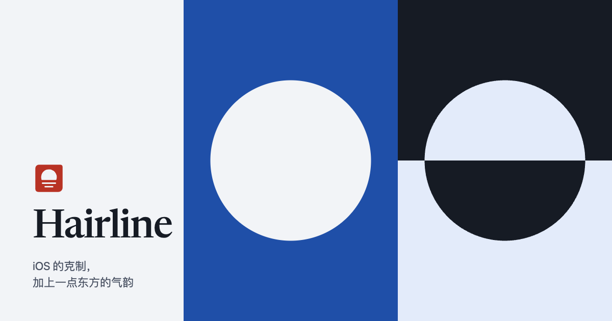
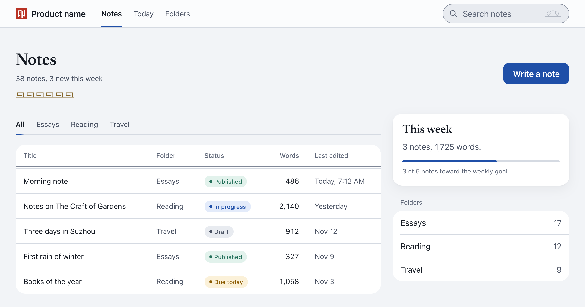
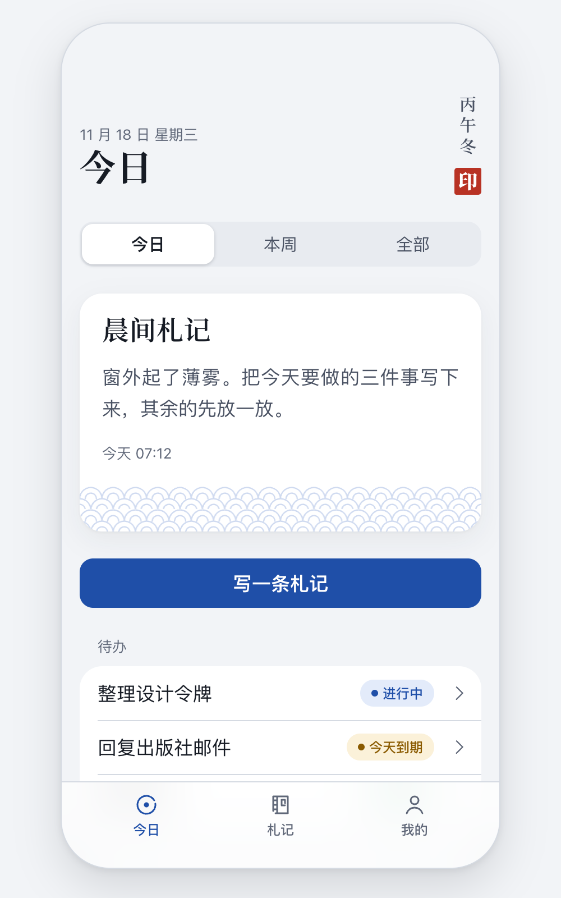
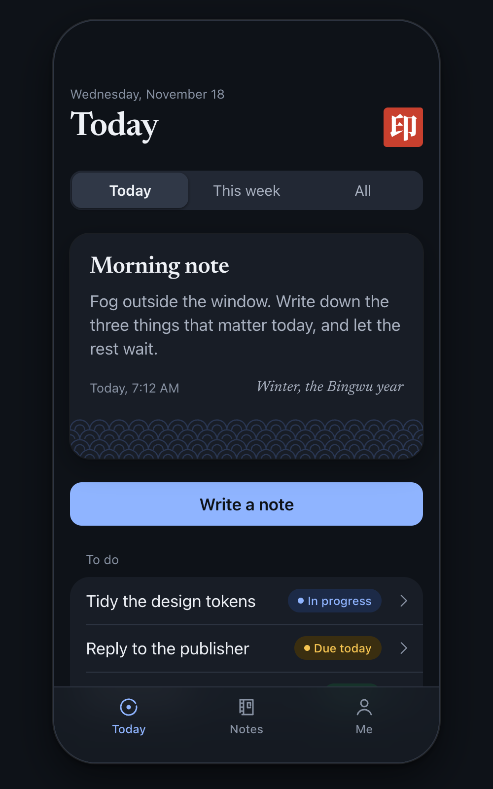

<p align="center">
  
</p>

<h1 align="center">毫 Hairline</h1>

<p align="center">
  A design system with the restraint of iOS and a trace of Chinese character.<br>
  One stylesheet, one script, one token file. No framework, no build step.
</p>

<p align="center">
  <a href="https://hairline.gavinwayne.com">Documentation</a> ·
  <a href="README.zh-CN.md">简体中文</a> ·
  <a href="CHANGELOG.md">Changelog</a>
</p>

<p align="center">
  <a href="https://github.com/itsgavinwayne/hairline/actions/workflows/check.yml"></a>
  <a href="LICENSE"></a>
  <a href="LICENSE-docs.md"></a>
</p>

<p align="center">
  
</p>

<p align="center">
  
  
</p>

## What it is

Hairline takes its structure, density, and interaction from iOS, and its color, display type, and use of empty space from Chinese craft: azurite blue, the cinnabar red of a seal, the white of rice paper.

- **Plain HTML and CSS.** Components are class names on native elements. Works with any framework or none.
- **Bilingual by design.** Chinese and English each get their own type scale, line height, and punctuation rules, switched by the `lang` attribute.
- **Light and dark.** Every color token has both values; set `data-theme` or follow the system.
- **Four kinds of output.** Interfaces, long-form reading, posters and print, and brand marks share one foundation.
- **Accessible defaults.** Native controls first, visible focus, keyboard support, WCAG 2.2 AA contrast, reduced motion respected.
- **Checked on every commit.** Token consistency, behavior tests, and an audit of every component for overflow, clipping, contrast, and centering.

## Quick start

Add the stylesheet and the optional script. This link serves the files straight from this repository:

```html
<link rel="stylesheet" href="https://cdn.jsdelivr.net/gh/itsgavinwayne/hairline@main/dist/hairline.css">
<script src="https://cdn.jsdelivr.net/gh/itsgavinwayne/hairline@main/dist/hairline.js" defer></script>
```

Or copy the three files in [`dist/`](dist) into your project:

| File | What it holds |
| --- | --- |
| `hairline.css` | Every token and every component, both themes |
| `hairline.js` | Behavior for dialogs, menus, the calendar, toasts. Optional: components render without it |
| `tokens.json` | The raw token data, for design tools and other platforms |

Then write markup:

```html
<html lang="en" data-theme="light">
  ...
  <button class="hao-btn">Save changes</button>
  <label class="hao-switch">Daily reminder <input type="checkbox" role="switch" checked></label>
</html>
```

Classes start with `hao-` and CSS variables with `--hao-`, so nothing collides with what you already have. Every component page in the documentation has a live demo and copy-ready markup.

Not on npm yet. Until a tagged release exists, `@main` in the link above follows the latest commit; pin a commit hash if you need it to stay put.

## Three rules

What separates Hairline from a Chinese-style skin is what it leaves out. Check these before you ship a screen:

1. **One touch of cinnabar.** Red appears once per screen: a seal, a badge, or a destructive button.
2. **One scene per screen.** At most one pattern, illustration, or mounted picture. Settings and forms get none.
3. **One image per control.** Progress uses one metaphor; the moon appears in one place.

The full reasoning, and the five aesthetic standards behind it (plain, empty, pale, fine, off-center), are in the [documentation](https://hairline.gavinwayne.com).

## Use it with AI

[`skills/hairline/`](skills/hairline) is a skill package for AI coding assistants: a one-page guide, every guideline, the token tables, and each component's write-up with copy-ready markup in both languages.

- **Claude Code:** copy the `skills/hairline` folder into `~/.claude/skills/` (all projects) or `.claude/skills/` (one project), then ask for something like "build a settings page with Hairline".
- **Other assistants:** point them at `skills/hairline/SKILL.md`; it says what every other file is for.
- **Assistants that only read the web:** the documentation site serves `llms.txt` and `llms-full.txt`.

## What's inside

| Path | Contents |
| --- | --- |
| `source/` | The only place edited by hand: tokens, components, icons, guidelines. English text lives in `source/en/` |
| `dist/` | The three generated files people use |
| `skills/hairline/` | The AI skill package; `SKILL.md` is written by hand, the rest is generated |
| `build_site.py` | Checks the tokens, then generates `dist/` and the documentation site |
| `tests/` | Behavior tests and the component audit, as pages that run in a browser |
| `tools/` | Checks, the skill builder, screenshots |

## Develop

Requires Python 3 and, for the browser checks, Chrome or Chromium. There are no dependencies to install.

```bash
python3 build_site.py
```

```bash
python3 -m http.server 4173 --directory site
```

Open <http://localhost:4173>. Before committing, run every check with one command:

```bash
python3 tools/check_all.py
```

See [CONTRIBUTING.md](CONTRIBUTING.md) for the conventions. Edit `source/`, never `dist/`; commit the regenerated `dist/` and `skills/` together with your change.

## Browser support

The last two years of Chrome, Safari, Edge, and Firefox. A few refinements (automatic spacing between Chinese and Latin text, the styled select panel) rely on newer features and fall back quietly where they are missing.

## Good fit, poor fit

Suited to reading, writing, notes, calendars, lifestyle, culture and education, personal brands, and content sites. Less suited to very dense professional tools, games, and products for children: they want a density or a mood that runs against this system's empty space and restraint.

## License

- Code (stylesheets, scripts, tokens, icons, tools): [MIT](LICENSE).
- Guidelines and documentation: [CC BY 4.0](LICENSE-docs.md).
- The name "毫 / Hairline" and its mark are reserved. Say your product is built with Hairline; if you publish a modified version, give it another name.

Details are in [LICENSE-docs.md](LICENSE-docs.md).
