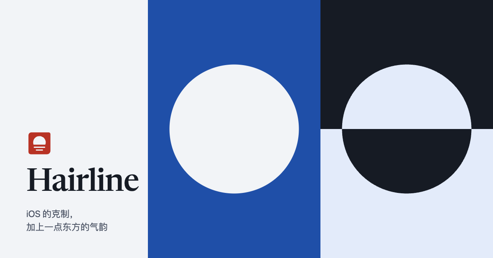
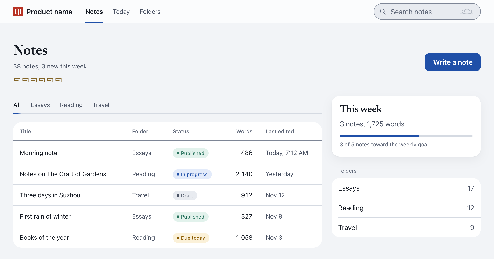
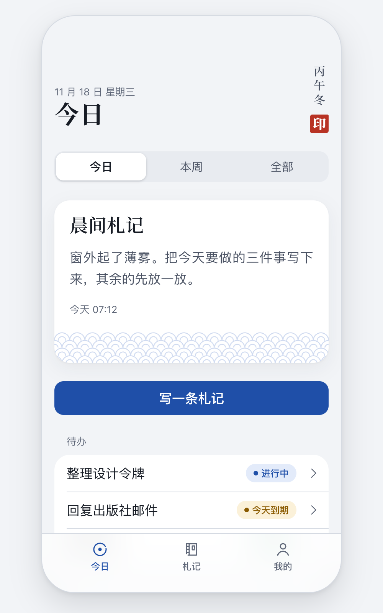
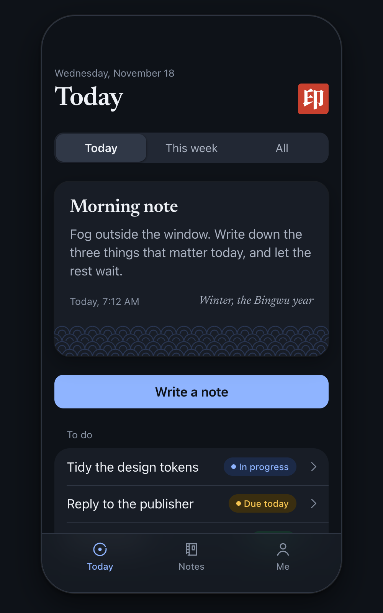

<p align="center">
  
</p>

<h1 align="center">毫 Hairline</h1>

<p align="center">
  iOS 的克制，加一点东方气韵的设计系统。<br>
  一份样式表、一份脚本、一份令牌。不依赖框架，不需要构建。
</p>

<p align="center">
  <a href="https://hairline.gavinwayne.com">文档</a> ·
  <a href="README.md">English</a> ·
  <a href="CHANGELOG.md">更新日志</a>
</p>

<p align="center">
  <a href="https://github.com/itsgavinwayne/hairline/actions/workflows/check.yml"></a>
  <a href="LICENSE"></a>
  <a href="LICENSE-docs.md"></a>
</p>

<p align="center">
  
</p>

<p align="center">
  
  
</p>

## 它是什么

毫的结构、密度、交互照 iOS 的规矩来；颜色、标题字、留白取自中国工艺：石青的蓝、印章的朱砂红、宣纸的白。

- **纯 HTML 和 CSS。** 组件就是原生元素上的类名。用什么框架都行，不用框架也行。
- **天生双语。** 中文和英文各有自己的字号阶梯、行高和标点规则，靠 `lang` 属性切换。
- **昼夜两套主题。** 每个颜色令牌都有两套值；设 `data-theme`，或跟随系统。
- **四类产物。** 界面、长文阅读、海报与印刷、品牌标志，共用同一个基础。
- **默认无障碍。** 优先用原生控件，焦点看得见，支持键盘，对比度达到 WCAG 2.2 AA，尊重「减弱动态效果」。
- **每次提交都检查。** 查令牌一致性，跑行为测试，逐个组件审溢出、裁切、对比度和居中。

## 快速上手

引入样式表和可选的脚本。下面的链接直接从这个仓库取文件：

```html
<link rel="stylesheet" href="https://cdn.jsdelivr.net/gh/itsgavinwayne/hairline@main/dist/hairline.css">
<script src="https://cdn.jsdelivr.net/gh/itsgavinwayne/hairline@main/dist/hairline.js" defer></script>
```

或者把 [`dist/`](dist) 里的三个文件拷进你的项目：

| 文件 | 装的是什么 |
| --- | --- |
| `hairline.css` | 全部令牌和全部组件，昼夜两套主题都在内 |
| `hairline.js` | 弹窗、菜单、月历、轻提示的行为。可选：没有它组件也能渲染 |
| `tokens.json` | 原始令牌数据，给设计工具和其他平台用 |

然后写标记：

```html
<html lang="zh-CN" data-theme="light">
  ...
  <button class="hao-btn">保存修改</button>
  <label class="hao-switch">每日提醒 <input type="checkbox" role="switch" checked></label>
</html>
```

类名都以 `hao-` 开头，CSS 变量以 `--hao-` 开头，不会和你已有的东西冲突。文档里每个组件页都有可以动手试的演示和照抄即用的标记。

还没上 npm。在出现打好标签的版本之前，上面链接里的 `@main` 跟着最新提交走；需要它保持不动，就固定到某个提交的哈希。

## 三条规矩

毫和中国风皮肤的区别，在于它不放什么。交付一屏之前，先照这三条查一遍：

1. **朱砂一处。** 一屏里红色只出现一次：一方印、一个角标，或一个删除按钮。
2. **一屏一景。** 纹样、插画、装裱的画，一屏至多一个。设置页和表单页一个也不放。
3. **形随控件。** 同一屏的进度只用一种意象；月亮在一屏里只出现一处。

完整的道理，和背后的五条审美标准（素、空、淡、细、偏），见[文档](https://hairline.gavinwayne.com)。

## 配合 AI 使用

[`skills/hairline/`](skills/hairline) 是给 AI 编程助手用的技能包：一页指南、全部规范、令牌表，以及每个组件的说明和照抄即用的标记，中英文都有。

- **Claude Code：** 把 `skills/hairline` 文件夹拷到 `~/.claude/skills/`（所有项目）或 `.claude/skills/`（单个项目），然后提个要求，比如「用毫做一个设置页」。
- **其他助手：** 让它们读 `skills/hairline/SKILL.md`；那份文件写了其余每个文件是干什么的。
- **只会读网页的助手：** 文档站提供 `llms.txt` 和 `llms-full.txt`。

## 仓库里有什么

| 路径 | 内容 |
| --- | --- |
| `source/` | 唯一手工编辑的地方：令牌、组件、图标、规范。英文稿放在 `source/en/` |
| `dist/` | 大家实际用的那三个生成文件 |
| `skills/hairline/` | AI 技能包；`SKILL.md` 手写，其余是生成的 |
| `build_site.py` | 检查令牌，然后生成 `dist/` 和文档站 |
| `tests/` | 行为测试和组件审查，做成跑在浏览器里的页面 |
| `tools/` | 各项检查、技能包生成器、截图 |

## 开发

需要 Python 3；跑浏览器检查还需要 Chrome 或 Chromium。没有要装的依赖。

```bash
python3 build_site.py
```

```bash
python3 -m http.server 4173 --directory site
```

打开 <http://localhost:4173>。提交之前，用一条命令跑完全部检查：

```bash
python3 tools/check_all.py
```

各项约定见 [CONTRIBUTING.md](CONTRIBUTING.md)。只编辑 `source/`，不动 `dist/`；重新生成的 `dist/` 和 `skills/` 要连同你的改动一起提交。

## 浏览器支持

支持最近两年的 Chrome、Safari、Edge 和 Firefox。有几处细节（中文与西文之间自动留空、下拉选择的面板样式）依赖较新的特性，在不支持的地方悄悄退回原样。

## 适用与不适用

适合阅读、写作、笔记、日历、生活方式、文化与教育、个人品牌和内容网站。不太适合非常密集的专业工具、游戏和儿童产品：它们要的密度或气氛，和这套系统的留白、克制相反。

## 许可

- 代码（样式表、脚本、令牌、图标、工具）：[MIT](LICENSE)。
- 规范和文档：[CC BY 4.0](LICENSE-docs.md)。
- 「毫 / Hairline」这个名字和它的标志是保留的。可以说你的产品是用毫 Hairline 做的；要发布改过的版本，就给它另起一个名字。

细节见 [LICENSE-docs.md](LICENSE-docs.md)。
